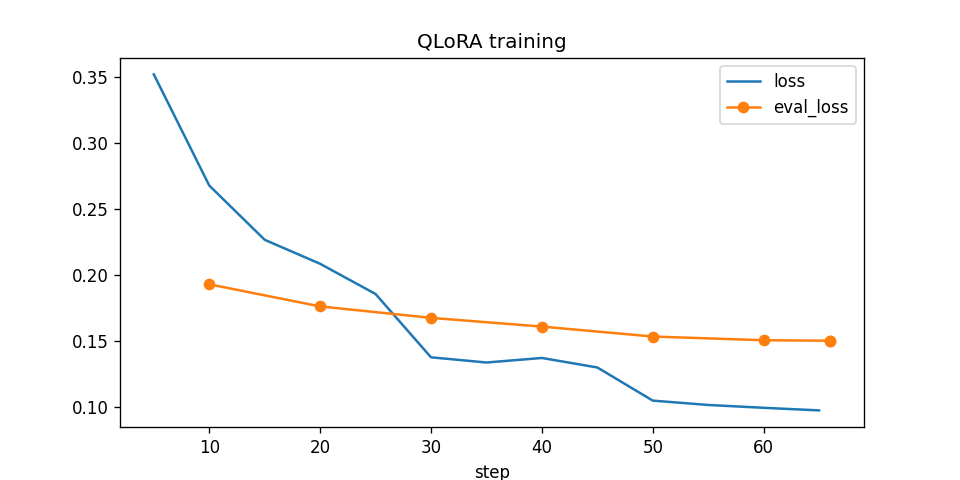
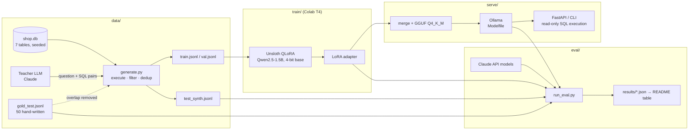

# slm-finetune: a 1.5B model that writes SQL for one database

Fine-tune a small open model (Qwen2.5-1.5B-Instruct) with QLoRA for one narrow job, turning English questions into SQLite
queries for a fixed e-commerce schema, and measure it against untuned baselines on **accuracy, latency and cost**.
The fine-tuned model runs locally through Ollama, so a question never leaves your machine.

**Headline:** 340 synthetic training pairs and 7.6 minutes of QLoRA on a free Colab T4 took Qwen2.5-1.5B from
**32% to 56%** execution accuracy on 50 hand-written test questions. As a 986 MB Q4_K_M GGUF on a laptop GPU it scores
**62%** at **2.3 s p50**, ahead of an untuned Llama 3.2 3B (52%), a model twice its size, on the same machine. The whole
pipeline, from data generation to serving, cost $0: the training data came from a local open-weight teacher.

On Hugging Face: [LoRA adapter](https://huggingface.co/Yash06B/sql-qwen2.5-1.5b-lora) ·
[GGUF for Ollama](https://huggingface.co/Yash06B/sql-qwen2.5-1.5b-GGUF) ·
[dataset](https://huggingface.co/datasets/Yash06B/shop-text-to-sql)

Part of a series: [claude-overlay](https://github.com/<you>/claude-overlay) (local-first desktop copilot, Claude + Ollama) ·
RAG with an eval harness · MCP agent for issue triage · **this repo** (model-level work: data, training, eval, serving).

## Why this task

Text-to-SQL on a known schema is a narrow, high-volume task where a small specialist should be able to beat a generalist,
and it has an objective metric: **execution accuracy**. Run the generated SQL against the database and compare the rows
with the gold query's rows. No LLM-as-judge, no string matching.

## Results

Generated by `python eval/report.py --update-readme` from the runs in `results/` (per-question predictions included).
Nothing is estimated or hand-entered.

<!-- RESULTS:START -->
**Test set: `gold_test`** (n=50)

| Model | Hardware | Exec. accuracy (95% CI) | Easy / Med / Hard | Valid SQL | p50 latency | p95 latency | Cost / 1k requests |
|---|---|---|---|---|---|---|---|
| Qwen2.5-1.5B QLoRA, Q4_K_M GGUF (ours) | RTX 4050 laptop, Ollama | **62.0%** (50-74) | 93 / 70 / 20 | 86% | 2.34s | 2.77s | n/a |
| Qwen2.5-1.5B QLoRA (ours) | Colab T4 (4-bit) | **56.0%** (42-70) | 80 / 65 / 20 | 88% | 4.44s | 9.88s | $0.483 |
| Llama 3.2 3B (base, zero-shot) | RTX 4050 laptop, Ollama | **52.0%** (38-66) | 80 / 65 / 7 | 86% | 2.59s | 3.29s | n/a |
| Qwen2.5-1.5B-Instruct (base) | Colab T4 (4-bit) | **32.0%** (20-44) | 53 / 35 / 7 | 66% | 3.42s | 6.41s | $0.355 |

**Test set: `test_synth`** (n=33)

| Model | Hardware | Exec. accuracy (95% CI) | Easy / Med / Hard | Valid SQL | p50 latency | p95 latency | Cost / 1k requests |
|---|---|---|---|---|---|---|---|
| Qwen2.5-1.5B QLoRA, Q4_K_M GGUF (ours) | RTX 4050 laptop, Ollama | **42.4%** (24-61) | 67 / 40 / 33 | 91% | 2.54s | 3.03s | n/a |
| Qwen2.5-1.5B QLoRA (ours) | Colab T4 (4-bit) | **39.4%** (24-55) | 67 / 47 / 17 | 85% | 6.03s | 9.75s | $0.605 |
| Llama 3.2 3B (base, zero-shot) | RTX 4050 laptop, Ollama | **15.2%** (6-27) | 33 / 20 / 0 | 94% | 2.78s | 3.41s | n/a |
| Qwen2.5-1.5B-Instruct (base) | Colab T4 (4-bit) | **12.1%** (3-24) | 33 / 7 / 8 | 61% | 4.08s | 6.97s | $0.410 |
<!-- RESULTS:END -->

How to read it:

- **Exec. accuracy**: share of questions whose SQL returns exactly the gold rows (order-sensitive only when the gold query
  has an outer `ORDER BY`; column order and float rounding to 2 decimals are ignored). The 95% CI is a bootstrap over questions;
  with 50 gold questions it is wide, so the synthetic test split is reported as well.
- **Test sets**: `gold_test` is 50 hand-written questions (15 easy, 20 medium, 15 hard) checked against the database and
  never shown to the teacher model or used in training. `test_synth` is a held-out slice of the generated data
  (in-distribution); near-duplicates of any test question are removed from train.
- **Latency**: wall clock per request, one request at a time, after a warm-up call. p50 / p95 over the test set.
- **Cost per 1k requests**: API models use list prices × measured tokens (thinking tokens included). Self-hosted models
  use seconds per request × the GPU's hourly price (`--gpu-hourly-usd`), which assumes no batching and so overstates
  the cost of a real server. A laptop running Ollama is shown as `n/a` unless you set an hourly price. The Colab rows use
  $0.35/h as a placeholder T4 price; replace it with your provider's rate.

### What the numbers say

- **Fine-tuning works, even with 340 pairs.** +24 points on the hand-written gold set (32% → 56%, same 4-bit runtime)
  and +27 on the in-distribution synthetic split (12% → 39%). Valid-SQL rate goes from 66% to 88%, so the model mostly
  stopped writing queries that don't run against this schema.
- **The 4-bit GGUF did not lose accuracy here.** 62% for the merged Q4_K_M model in Ollama vs 56% for the 4-bit base +
  unmerged adapter in transformers. The two runtimes use different quantization and kernels, and the gap is inside the
  confidence intervals, so read it as "no measurable loss", not as a gain.
- **Hard questions are the gap.** 93% easy, 70% medium, 20% hard (GGUF, gold set). Of the 22 gold failures for the
  transformers run, 6 don't execute: invented tables or columns (`shipments`, `orders.loyalty_tier`) and nested aggregates
  (`AVG(SUM(...))`). The rest return wrong rows on multi-step logic: window functions, year-over-year comparisons,
  profit vs revenue.
- **The metric is strict.** 2 of those failures (g013, g032) return the right rows plus one extra column. Strict
  execution accuracy counts that as wrong, which is the standard choice, and the per-question `predictions.jsonl`
  files let you check every call.
- **Latency on the laptop beats the cloud T4.** The Colab rows run an unmerged LoRA adapter through `transformers`,
  which is the slowest way to serve it. The merged GGUF in Ollama on a laptop RTX 4050 answers at 2.3 s p50 / 2.8 s p95,
  mostly spent reading the ~650-token schema prompt.
- **Not measured yet:** large API models. `eval/run_eval.py --backend anthropic:claude-haiku-5-5` (and Sonnet 5.5) adds
  those rows. That needs an API key and a few cents, and is the main next step.

### Training run

| | |
|---|---|
| Data | 403 pairs kept of 679 proposed (59%) by `qwen2.5-coder:7b` via Ollama, split 340 train / 20 val / 33 test |
| Hardware / time | Colab Tesla T4, 7.6 min wall clock, 2.1 GB peak VRAM |
| Steps | 66 (3 epochs × 340 pairs / effective batch 16) |
| Loss | train 0.352 → 0.098, eval 0.193 → 0.150 (flattening by epoch 3) |

Curve and raw logs: [`results/training/`](results/training/).



## Architecture



One prompt format (`sqlbench/prompts.py`: system prompt with the full schema, then the question) is shared by data
generation, training, every evaluated model and the server, so the comparison is apples to apples and the served model
sees exactly what it was trained on.

## Repo layout

| Path | What it does |
|---|---|
| `sqlbench/schema.py` | Schema DDL + deterministic database builder (same bytes on every machine) |
| `sqlbench/execution.py` | Read-only SQL execution with timeout, and the execution-accuracy comparison |
| `sqlbench/prompts.py` | The single prompt format and SQL extraction from model output |
| `sqlbench/llm.py` | Backends with one interface: `ollama:`, `anthropic:`, `openai:` (any compatible server), `hf:` (transformers + LoRA) |
| `data/generate.py` | Synthetic pair generation with a teacher LLM, validation, dedup, train/val/test split |
| `data/gold_test.jsonl` | 50 hand-written test questions |
| `train/train.py` | QLoRA fine-tuning (Unsloth + TRL), CSV logging (+ optional W&B) |
| `train/colab_train.ipynb` | End-to-end notebook: train → eval → GGUF → download / push |
| `eval/run_eval.py` | Scores any backend on a test set: accuracy, p50/p95 latency, tokens, cost |
| `eval/report.py` | Builds the results table (bootstrap CIs) and writes it into this README |
| `serve/export_gguf.py` | Merge adapter, quantize to GGUF, write the Modelfile |
| `serve/app.py` | CLI and FastAPI demo backed by the local Ollama model |
| `scripts/push_to_hf.py` | Publish adapter, GGUF and dataset to Hugging Face (dry run unless `--yes`) |

## Training setup

| Hyperparameter | Value | Why |
|---|---|---|
| Base model | `unsloth/Qwen2.5-1.5B-Instruct` | Apache-2.0, strong at code for its size, fits a free T4 easily |
| Method | QLoRA: 4-bit NF4 base, LoRA on all attention + MLP projections | Full fine-tune quality at a fraction of the memory |
| LoRA rank / alpha / dropout | 16 / 32 / 0 | Standard starting point; the task is narrow |
| Learning rate, schedule | 2e-4, cosine, 3% warmup | Usual LoRA range |
| Effective batch | 16 (4 × 4 grad. accumulation) | |
| Epochs | 3 for the current 340-pair set, 2 for ~3k pairs | Watch `eval_loss` in `train_log.csv`; synthetic data overfits fast |
| Max sequence length | 2048 | Schema prompt is ~650 tokens, answers are short |
| Loss | Assistant tokens only (`train_on_responses_only`) | Don't spend capacity re-learning the fixed schema prompt |
| Optimizer | AdamW 8-bit, weight decay 0.01 | |

Every run writes `hyperparams.json`, `train_log.csv` and `train_metrics.json` (wall clock, GPU, peak VRAM) next to the adapter.

## Reproduce

### 0. Setup (Windows, macOS or Linux)

```bash
python -m venv .venv
```
```bash
.venv/Scripts/python -m pip install -r requirements.txt
```
(On macOS/Linux use `.venv/bin/python`.) Install [Ollama](https://ollama.com) for local serving and evaluation.

```bash
.venv/Scripts/python -m sqlbench.schema
```

### 1. Generate training data

With Claude as the teacher (paid; prints the running cost). Set `ANTHROPIC_API_KEY` first.

```bash
.venv/Scripts/python data/generate.py --backend anthropic:claude-opus-5-5 --target 3000 --workers 8
```

Free alternative: a local open-weight teacher through Ollama. A Qwen teacher (Apache-2.0) keeps the dataset and the
fine-tuned model free of licence strings. It takes hours instead of minutes (about 63 tok/s for a 4B model on a 6 GB
laptop GPU), so run it overnight; `--resume` picks up where a stopped run left off.

```bash
ollama pull qwen2.5-coder:7b
```
```bash
.venv/Scripts/python data/generate.py --backend ollama:qwen2.5-coder:7b --target 3000 --workers 1
```

The execution filter catches broken SQL from any teacher, but not SQL that runs and answers the wrong question, so a
weaker teacher means noisier labels. The `stats.json` acceptance rate and the gold-set score show how much that costs.

Output: `data/generated/{train,val,test_synth}.jsonl` and `stats.json` (acceptance rate, reject reasons, cost).
Commit `data/generated/` so the Colab notebook can clone it.

### 2. Train on a free GPU (Colab)

1. Push this repo to GitHub (including `data/generated/`).
2. Open `train/colab_train.ipynb` in Colab (File → Upload notebook, or open it from GitHub).
3. Runtime → Change runtime type → **T4 GPU**.
4. In the first code cell set `REPO_URL` to your repo, then Runtime → **Run all**.
5. The notebook trains, evaluates base vs fine-tuned on both test sets, exports `serve/gguf/*.gguf` and downloads
   `slm-artifacts.zip`. Unzip it into this folder on your PC.

Kaggle works the same way (Settings → Accelerator → GPU, Internet on). A local NVIDIA GPU with 6 GB+ also fits the 1.5B
QLoRA run: use WSL2 or Linux, `pip install unsloth`, then `python train/train.py`.

### 3. Serve locally with Ollama

```bash
ollama create sql-qwen -f serve/Modelfile
```
```bash
.venv/Scripts/python serve/app.py ask "Which 5 customers spent the most on delivered orders in 2025?"
```
```bash
.venv/Scripts/python serve/app.py serve --port 8008
```

### 4. Evaluate

```bash
.venv/Scripts/python eval/run_eval.py --backend ollama:sql-qwen --label "Qwen2.5-1.5B QLoRA, Q4_K_M (ours)" --hardware "RTX 4050 laptop, Ollama"
```
```bash
.venv/Scripts/python eval/run_eval.py --backend anthropic:claude-haiku-5-5 --workers 4
```
```bash
.venv/Scripts/python eval/run_eval.py --backend anthropic:claude-sonnet-5-5 --workers 4
```
```bash
.venv/Scripts/python eval/report.py --update-readme
```

Add `--test-set synth` to any eval command for the in-distribution split, and `--limit 5` for a quick check.
The Claude runs cost real money: 50 gold questions × ~700 input tokens is cents on Haiku 5.5, a bit more on Sonnet 5.5.

### 5. Publish to Hugging Face

```bash
.venv/Scripts/python scripts/push_to_hf.py --user <hf-username>
```

That is a dry run listing every file and repo. Add `--yes` to upload. The model card embeds the results table.

## Design decisions

- **Execution accuracy over exact match.** Many SQL strings are correct; the rows are what matter.
- **Hand-written gold test set.** A test set produced by the same teacher that wrote the training data would reward
  copying the teacher's style. The gold set is written separately and overlap with it is filtered out of training.
- **Read-only by construction.** Queries run on a `mode=ro` SQLite connection with a statement allow-list and a timeout,
  in eval and in the server.
- **Deterministic database.** Seeded generator, so results reproduce on any machine without shipping the `.db`.

## Next steps

- Add the API rows (Claude Haiku 5.5, Sonnet 5.5) to the same table, so the cost/latency comparison is complete.
- Finish the dataset (`generate.py --resume`, target 3k pairs) and plot accuracy vs training-set size (340 → 1k → 3k).
- LLM-judge pass on generated pairs (does the SQL answer the question?) to cut label noise, and measure its effect.
- Ablations: rank 8 vs 16 vs 64, 1 vs 3 epochs, 500 vs 3k vs 10k pairs (accuracy vs data size curve).
- Qwen2.5-3B and Llama-3.2-3B with the same pipeline; Q4_K_M vs Q8_0 accuracy/latency trade-off.
- Throughput numbers with batching (vLLM via the `openai:` backend) for a fairer self-hosted cost.
- Plug the model into claude-overlay as a local "ask your database" tool.
